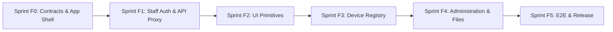

# AMTRAV Frontend Sprint Roadmap

Authoritative sprint definitions live in [`docs/planning/sprints.toml`](./sprints.toml).
This document is synchronized from `sprints.toml` and reflects sprint status, dependencies, and deliverables for the `AMTRAV-frontend` repository.

The admin panel is planned against the backend API contract: [Swagger UI](https://dev.amortrav.com/swagger-ui/) (OpenAPI at `/api/v1/openapi.json`).

---

## 1. Roadmap Overview (Admin Panel Sprints F0–F5)

| Sprint | Title | Risk Level | Status | Primary Output |
| :--- | :--- | :--- | :--- | :--- |
| **Sprint F0** | API Contracts, Mock Data & Root App Shell | Level 1 | **Proposed** | API types from the OpenAPI contract, mock fixtures, role-aware App Shell & routes |
| **Sprint F1** | Staff Authentication & Same-Origin API Proxy | Level 3 | **Unstarted** | API proxy, staff login, session refresh and logout, route protection |
| **Sprint F2** | Core Reusable UI Primitives | Level 1 | **Unstarted** | DataTable, StatusBadge, RoleBadge, ModalShell, ConfirmDialog, error handling, secret reveal |
| **Sprint F3** | Device Registry | Level 2 | **Unstarted** | Device list, registration, detail and edit, claim code rotation, revocation, audit |
| **Sprint F4** | Administration & Private Files | Level 2 | **Unstarted** | User list, role changes, manufacturer creation, files area |
| **Sprint F5** | End-to-End Tests & Release Readiness | Level 2 | **Unstarted** | Playwright suite, error boundaries, deployment configuration |

### What the API offers today

| Area | Endpoints | Used by the admin panel in |
| :--- | :--- | :--- |
| Staff sign-in and session | `POST /auth/login`, `POST /auth/refresh`, `POST /auth/logout`, `GET /auth/me` | F1 |
| Device registry | `GET/POST /devices`, `GET/PATCH /devices/{id}`, `POST /devices/{id}/claim-code`, `POST /devices/{id}/revoke`, `GET /devices/{id}/audit` | F3 |
| Administration | `GET /admin/users`, `PATCH /admin/users/{id}/role`, `POST /admin/manufacturers`, `GET /auth/jobs/{id}` | F4 |
| Private files | `GET/POST /files`, `GET /files/{id}`, `GET /files/{id}/download` | F4 |

Not for the admin panel: Google sign-in (`/auth/google*`) and device claiming (`POST /devices/claim`) are for mobile users in the AMTRAV+ app. Location, telemetry, lock and notification views are not planned until the backend provides those services.

Constraints that shape the plan: the API returns tokens in JSON and has no CORS, so the admin panel calls it through its own server (F1); lists page with `limit` and `offset` and return no total count (F2).

---

## 2. Blocking Decisions

| Decision | Summary | Status | Blocks | Safe Meanwhile |
| :--- | :--- | :--- | :--- | :--- |
| **FD1** | Admin visual design: reuse the AMORTRAV tokens and components from `landing_page`, or provide a dedicated admin design | Open | Sprint F2 styling | Sprint F0 and Sprint F1 |
| **FD2** | Server-state approach: TanStack Query in client components, or Next.js server components and route handlers | Open | Sprint F3, Sprint F4 | Sprint F0 to F2 |
| **FD3** | Typed mock fixtures that return the real API DTOs for development without a backend | Open | Sprint F0 item 2 | Sprint F0 contracts |
| **FD4** | Session handling: the Next.js server keeps both tokens in HttpOnly, Secure, SameSite=Strict cookies and proxies `/api/v1` | Open | Sprint F1 | Sprint F0 with a mocked session |
| **FD5** | Admin panel audience: administrators only, or administrators and manufacturers | Open | Sprint F1 item 4 | Role-aware shell for both roles |

---

## 3. Sprint Detail

### Sprint F0: API Contracts, Mock Data & Root App Shell
- **Risk Level**: Level 1
- **Order**: 0
- **Objective**: Define TypeScript types that match the backend API contract, provide typed mock data, and build the role-aware App Shell with the admin routes.
- **Tasks**:
  - `F0-1`: Define TypeScript types matching the backend OpenAPI contract: `User`, `Role`, `TokenPair`, `Credentials`, `Device`, `ProvisionedDevice`, `RegisterDevice`, `UpdateDevice`, `DeviceAudit`, `FileMetadata`, `JobReceipt`, `JobResult`, `ManufacturerResponse`, `RoleUpdate`, `ErrorResponse`.
  - `F0-2`: Create typed mock fixtures that return those DTOs, paginate with `limit` and `offset`, and use the API error envelope.
  - `F0-3`: Build the responsive App Shell with the signed-in user, role badge and role-aware navigation.
  - `F0-4`: Wire route skeletons for `/login`, `/devices`, `/devices/[id]`, `/users` and `/files`.
- **Exit Gate**: App Shell renders on desktop and mobile; all routes navigate without errors; `lint:admin` and `build:admin` pass.

---

### Sprint F1: Staff Authentication & Same-Origin API Proxy
- **Risk Level**: Level 3
- **Order**: 1
- **Objective**: Sign staff in with the API, keep their session on the Next.js server, and reach the API through a same-origin proxy.
- **Tasks**:
  - `F1-1`: Same-origin proxy route that forwards `/api/v1` requests and adds the Bearer token from the HttpOnly cookie.
  - `F1-2`: Login page with `POST /auth/login`; one generic error for any 401; honour `Retry-After` on 429.
  - `F1-3`: Session lifecycle: tokens in HttpOnly cookies, single-flight refresh with `POST /auth/refresh`, logout with `POST /auth/logout`.
  - `F1-4`: Route protection with `GET /auth/me`; refuse the `user` role; 403 page for manufacturers on administrator routes.
- **Exit Gate**: A manufacturer and an administrator can sign in, stay signed in across token refresh, and sign out, against dev.amortrav.com.

---

### Sprint F2: Core Reusable UI Primitives
- **Risk Level**: Level 1
- **Order**: 2
- **Objective**: Build the reusable components every admin view needs, shaped by how the API pages, reports state and returns errors.
- **Tasks**:
  - `F2-1`: `DataTable` with `limit`/`offset` pagination (previous and next), loading and empty states.
  - `F2-2`: `StatusBadge` (registered, claimed, revoked) and `RoleBadge` (user, manufacturer, admin).
  - `F2-3`: `ModalShell` and `ConfirmDialog` with focus trap and Escape.
  - `F2-4`: Form fields and API error handling (400, 409 and 422 inline; 429 retry; 503 generic).
  - `F2-5`: One-time secret reveal for device claim codes.
- **Exit Gate**: Primitives are used by at least one route and documented in the code.

---

### Sprint F3: Device Registry
- **Risk Level**: Level 2
- **Order**: 3
- **Objective**: Let manufacturers manage their device inventory and administrators manage every device, using the device registry API.
- **Tasks**:
  - `F3-1`: Device list on `/devices` (`GET /devices`), scoped by role.
  - `F3-2`: Registration (`POST /devices`) with a one-time reveal of the returned `claim_code`.
  - `F3-3`: Device detail `/devices/[id]` and editing of `model` and `firmware_version` (`PATCH`).
  - `F3-4`: Claim code rotation for unclaimed devices and revocation with confirmation.
  - `F3-5`: Audit history (`GET /devices/{id}/audit`).
- **Exit Gate**: A manufacturer can register a device, hand over its claim code, edit it, rotate the code while unclaimed, revoke it and read its audit history.

---

### Sprint F4: Administration & Private Files
- **Risk Level**: Level 2
- **Order**: 4
- **Objective**: Let administrators manage accounts and manufacturers, and let staff keep private files, using the administration and files APIs.
- **Tasks**:
  - `F4-1`: User list on `/users` (`GET /admin/users`), administrators only.
  - `F4-2`: Role changes (`PATCH /admin/users/{id}/role`) with the API's rules explained.
  - `F4-3`: Manufacturer creation (`POST /admin/manufacturers`) with job polling via the `X-Job-Receipt` header.
  - `F4-4`: Files area: list, upload raw bytes with `X-File-Name` (up to 10 MiB), metadata and download.
- **Exit Gate**: An administrator can create a manufacturer and change roles; staff can upload, list and download their files.

---

### Sprint F5: End-to-End Tests & Release Readiness
- **Risk Level**: Level 2
- **Order**: 5
- **Objective**: Prove the staff journeys end to end against a real backend and prepare the admin panel for deployment.
- **Tasks**:
  - `F5-1`: Playwright tests: sign in, register a device, rotate its claim code, revoke it, read the audit history.
  - `F5-2`: Playwright tests: create a manufacturer, wait for the job, change a user role.
  - `F5-3`: Global error boundary, error toasts and loading skeletons.
  - `F5-4`: Per-environment API base URL and production deployment settings.
- **Exit Gate**: The end-to-end suite passes against the backend Compose stack and the production build is configured per environment.

---

## 4. Marketing Site (`landing_page`)

The public marketing site is tracked outside the F0–F5 admin sprints, with GitHub issues labelled [`landing_page`](https://github.com/raredevsgh/AMTRAV-frontend/issues?q=label%3Alanding_page).

- **Done:** four routes (`/`, `/features`, `/how-it-works`, `/for-brands`) built from the [AMORTRAV Figma file](https://www.figma.com/design/ATFfIHtQWHYG6S7rLRQCtG/AMORTRAV?node-id=2-2), desktop and mobile, merged in #29 (recorded in #30).
- **Waiting on owner input:** footer link destinations (#31), app-store links (#33), "Talk to us" / "Open the console" destinations (#34), testimonial content (#36), web font decision (#38), `experimental.agentFeedback` setting (#42).
- **Ready for collaborators:** social links once URLs are known (#32), `[VERSION]` placeholder (#37), image compression (#40), Safari/iOS QA (#41).
- **Needs design or backend work first:** tablet layout (#39), waitlist endpoint for the email signup (#35, depends on the backend).
