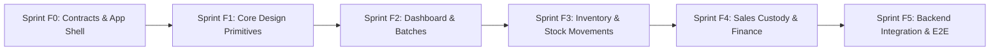

# AMTRAV Frontend Sprint Roadmap

Authoritative sprint definitions live in [`docs/planning/sprints.toml`](./sprints.toml).
This document is synchronized from `sprints.toml` and reflects sprint status, dependencies, and deliverables for the `AMTRAV-frontend` repository.

---

## 1. Roadmap Overview (MVP Sprints F0–F5)

| Sprint | Title | Risk Level | Status | Primary Output |
| :--- | :--- | :--- | :--- | :--- |
| **Sprint F0** | Frontend Contracts, Schema Types & Root App Shell | Level 1 | **Proposed** | TypeScript DTO schemas, mock adapters, responsive App Shell & MVP routes |
| **Sprint F1** | Core Reusable Design System Primitives | Level 1 | **Unstarted** | DataTable, MetricCard, ModalShell, StatusBadge, ExportButton |
| **Sprint F2** | Overview Dashboard & QR Batch Lifecycle | Level 2 | **Unstarted** | Dashboard KPIs, recent feed, Manufacturer list, batch creation modal & ledger |
| **Sprint F3** | Inventory Balances & Stock Movement Ledger | Level 2 | **Unstarted** | Stock balance bar, movement ledger, manual count adjustment modal |
| **Sprint F4** | Sales Team Custody & Financial Sales Ledger | Level 2 | **Unstarted** | Rep custody table, transfer modal, verified scans feed, sales ledger |
| **Sprint F5** | Axum Backend API Integration & E2E Validation | Level 3 | **Unstarted** | Live Axum API wiring, auth session handling, E2E test suite |

---

## 2. Blocking Decisions

| Decision | Summary | Status | Blocks | Safe Meanwhile |
| :--- | :--- | :--- | :--- | :--- |
| **FD1** | Adopt Tailwind CSS v4 token conventions with CSS variables and Geist font across `admin_panel` | Open | Sprint F1, Sprint F2 | Sprint F0 contracts |
| **FD2** | Adopt typed API client with TanStack React Query for data fetching and caching | Open | Sprint F2, Sprint F3, Sprint F4, Sprint F5 | Sprint F0, Sprint F1 |
| **FD3** | Adopt typed in-memory mock fixtures with simulated network latency | Open | Sprint F2 item 1 | Sprint F0 contracts |
| **FD4** | Define session and authentication token transport (HttpOnly cookie with CSRF header) | Open | Sprint F5 | Sprints F0 to F4 |

---

## 3. Sprint Detail

### Sprint F0: Frontend Contracts, Schema Types & Root App Shell
- **Risk Level**: Level 1
- **Order**: 0
- **Objective**: Establish TypeScript contracts matching Axum backend DTOs, typed mock client adapters, and initialize the responsive Root App Shell with navigation routes for the 5 MVP domains.
- **Tasks**:
  - `F0-1`: Define TypeScript schemas and DTO types matching Rust backend API contracts (`ManufacturerDto`, `BatchDto`, `StockMovementDto`, `SalesRepCustodyDto`, `TransactionDto`).
  - `F0-2`: Create typed mock client adapter and fixture data handlers so UI views run completely decoupled from backend service availability.
  - `F0-3`: Build responsive Root App Shell with collapsible sidebar (`SidebarNav`), top navigation bar (`GlobalHeader`), route layout, and mock tenant/auth context.
  - `F0-4`: Wire route skeletons for `/dashboard`, `/manufacturers`, `/sales`, `/inventory`, and `/finance` with breadcrumb navigation and metadata.
- **Exit Gate**: App Shell renders cleanly on desktop and tablet; all 5 MVP routes navigate without errors; `lint:admin` and `build:admin` pass.

---

### Sprint F1: Core Reusable Design System Primitives
- **Risk Level**: Level 1
- **Order**: 1
- **Objective**: Implement the reusable UI primitive components required across all 5 admin views to ensure consistent UX and zero duplicate styling.
- **Tasks**:
  - `F1-1`: Build `DataTable` component with client/server sorting, search filter, status chip rendering, and pagination controls.
  - `F1-2`: Build `MetricCard` KPI component with label, primary value, trend delta indicator, and optional icon.
  - `F1-3`: Build `ModalShell` and `ActionDrawer` dialog components with accessible focus trap, backdrop, title, and action footer.
  - `F1-4`: Build `StatusBadge` component supporting standard lifecycle states (`DRAFT`, `GENERATED`, `IN_TRANSIT`, `DELIVERED`, `VERIFIED`, `REJECTED`, `DAMAGED`).
  - `F1-5`: Build `ExportButton` utility component for one-click CSV export of table datasets.
- **Exit Gate**: Component test suite passing; all primitives documented and usable in views.

---

### Sprint F2: Overview Dashboard & QR Batch Lifecycle
- **Risk Level**: Level 2
- **Order**: 2
- **Objective**: Implement high-level operational telemetry on the Overview Dashboard and the entry point of the supply chain in Manufacturer management (QR batch creation).
- **Tasks**:
  - `F2-1`: Implement `KpiSummaryCards` on `/dashboard` displaying 4 core metrics (Total Generated, Bags in Custody, Warehouse Stock, Total Sold).
  - `F2-2`: Implement `RecentActivityTable` on `/dashboard` showing real-time unified feed of inventory transitions and scan verifications.
  - `F2-3`: Implement `ManufacturerList` on `/manufacturers` showing authorized production partners.
  - `F2-4`: Implement `CreateBatchModal` on `/manufacturers` with form validation (SKU, quantity, plant selection).
  - `F2-5`: Implement `BatchLedgerTable` on `/manufacturers` with status badges and download QR archive trigger.
- **Exit Gate**: Admin can view overview metrics, create a new QR batch with form validation, and inspect the batch ledger.

---

### Sprint F3: Inventory Balances & Stock Movement Ledger
- **Risk Level**: Level 2
- **Order**: 3
- **Objective**: Deliver central warehouse stock tracking, physical custody distribution split, and audit stock movement ledger.
- **Tasks**:
  - `F3-1`: Implement `StockBalanceBar` on `/inventory` showing the four-way breakdown (Warehouse, Sales Custody, Sold, Damaged).
  - `F3-2`: Implement `StockMovementTable` on `/inventory` listing timestamped transitions (`RECEIPT`, `DISPATCH`, `SCRAP`).
  - `F3-3`: Implement `RecordAdjustmentModal` on `/inventory` for recording damaged goods and manual count reconciliations.
  - `F3-4`: Connect stock filters and search by batch ID / SKU with CSV export on `/inventory`.
- **Exit Gate**: Inventory view accurately reflects warehouse stock vs custody vs sold, and tracks manual count adjustments.

---

### Sprint F4: Sales Team Custody & Financial Sales Ledger
- **Risk Level**: Level 2
- **Order**: 4
- **Objective**: Implement field sales rep custody tracking, bag handoff workflows, authenticated scan verification feed, and flat revenue transaction ledger.
- **Tasks**:
  - `F4-1`: Implement `SalesRepCustodyTable` on `/sales` displaying active bag count in custody vs. sold count per rep.
  - `F4-2`: Implement `TransferCustodyModal` on `/sales` to record stock handoff from warehouse to sales rep.
  - `F4-3`: Implement `VerifiedScansFeed` on `/sales` showing authenticated bag verification telemetry from field scans.
  - `F4-4`: Implement `GrossRevenueSummary` and `TransactionLedgerTable` on `/finance` displaying confirmed sales and payment logs.
  - `F4-5`: Add CSV export for sales ledger and rep custody reconciliations on `/sales` and `/finance`.
- **Exit Gate**: Admins can assign stock to sales reps, monitor customer scan activations in real time, and audit sales transactions.

---

### Sprint F5: Axum Backend API Integration & E2E Validation
- **Risk Level**: Level 3
- **Order**: 5
- **Objective**: Replace mock fixture adapters with live Axum backend REST endpoints, implement session token management, and verify end-to-end user workflows.
- **Tasks**:
  - `F5-1`: Configure live `fetch` / TanStack Query client with base URL, authentication headers, error envelopes, and retry logic.
  - `F5-2`: Wire live endpoints for Dashboard, Manufacturers, Inventory, Sales, and Finance against Axum backend.
  - `F5-3`: Implement error boundaries, toast notifications for API failures, and loading skeleton states.
  - `F5-4`: Add Playwright / Vitest integration tests covering full lifecycle: Batch creation -> Stock receipt -> Sales dispatch -> Scan verification.
- **Exit Gate**: Full end-to-end flow verified against live backend: Batch creation -> Stock receipt -> Sales dispatch -> Scan verification -> Sales record.

---

## 4. Marketing Site (`landing_page`)

The public marketing site is tracked outside the F0–F5 admin sprints, with GitHub issues labelled [`landing_page`](https://github.com/raredevsgh/AMTRAV-frontend/issues?q=label%3Alanding_page).

- **Done:** four routes (`/`, `/features`, `/how-it-works`, `/for-brands`) built from the [AMORTRAV Figma file](https://www.figma.com/design/ATFfIHtQWHYG6S7rLRQCtG/AMORTRAV?node-id=2-2), desktop and mobile, merged in #29 (recorded in #30).
- **Waiting on owner input:** footer link destinations (#31), app-store links (#33), "Talk to us" / "Open the console" destinations (#34), testimonial content (#36), web font decision (#38), `experimental.agentFeedback` setting (#42).
- **Ready for collaborators:** social links once URLs are known (#32), `[VERSION]` placeholder (#37), image compression (#40), Safari/iOS QA (#41).
- **Needs design or backend work first:** tablet layout (#39), waitlist endpoint for the email signup (#35, depends on the backend).
